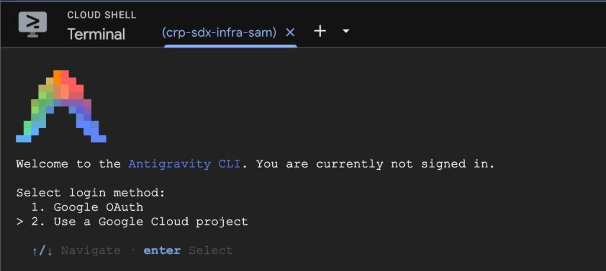
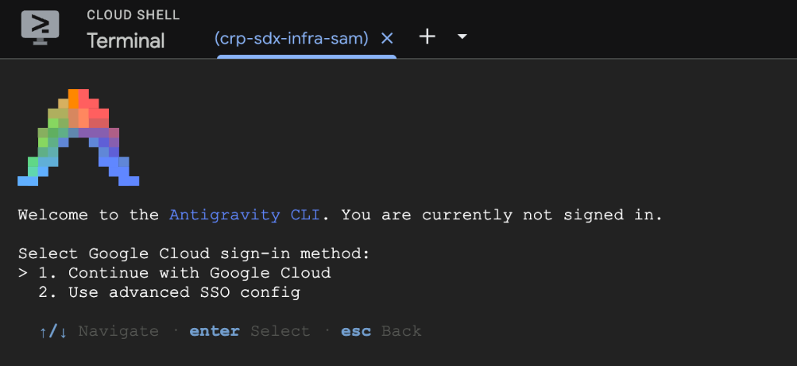

# FinCore | Laboratorio Práctico: Modernización de Java 8 a Java 21 LTS y Migración de App Engine a Cloud Run con Antigravity

Bienvenido al repositorio oficial del laboratorio práctico **FinCore Risk & Credit Origination Engine**.

En este taller práctico (ejecutado sobre **Qwiklabs / Google Cloud Shell**), tomarás una aplicación bancaria legada construida en **Java 8 + Spring Boot 2.7 (`javax.*` + JUnit 4)** configurada originalmente para **Google App Engine (`app.yaml`)**, la modernizarás paso a paso hacia **Java 21 LTS + Spring Boot 3.3 (`jakarta.*` + JUnit 5 + Virtual Threads)** utilizando **Google Antigravity**, y culminarás desplegándola como un contenedor cloud-native de alto rendimiento en **Google Cloud Run**.

---

## Arquitectura del Laboratorio: El Camino de Modernización

```mermaid
flowchart LR
    subgraph Legacy["Estado Inicial (Legado)"]
        J8["Java 8 (1.8)\nSpring Boot 2.7.18"]
        JVX["Namespaces javax.*\nJUnit 4 Vintage"]
        POOL["FixedThreadPool(2)\n~1,350 ms por lote I/O"]
        GAE["Google App Engine\n(app.yaml legado)"]
    end

    subgraph AGY["Google Antigravity (.agents/)"]
        RULES["AGENTS.md &\nReglas Bancarias"]
        SKILLS["5 Skills Automatizadas\n(.agents/skills/)"]
    end

    subgraph Modern["Estado Objetivo (Cloud-Native)"]
        J21["Java 21 LTS\nSpring Boot 3.3.5"]
        JKT["Jakarta EE 10 (jakarta.*)\nSealed Types, Records & Switch"]
        LOOM["Virtual Threads (Loom)\n~230 ms por lote (~6x)"]
        CRUN["Google Cloud Run\n(Temurin 21 JRE + Concurrency 80)"]
    end

    Legacy --> AGY --> Modern
```



---

## Qué Incluye el Portal Bancario Web (`FinCore Dashboard`)

La aplicación cuenta con una interfaz gráfica interactiva que te permite **validar visualmente cada misión** tanto en **Cloud Shell Web Preview (`puerto 8080`)** como en la URL pública de **Google Cloud Run (`.run.app`)**:

1. **Indicador de Entorno Cloud en la Barra Superior:**
   * En Cloud Shell muestra `Entorno: Cloud Shell / Local Preview`.
   * Al desplegar en **Google Cloud Run** (Misión 5), detecta automáticamente las variables `K_SERVICE` y `K_REVISION` y se ilumina en verde: **`CLOUD RUN ACTIVO: fincore-risk-engine`**.
2. **Banner de Telemetría Automática de Runtime:**
   * En **Java 8 + Spring Boot 2.7** se muestra en color **Ámbar (`MODO LEGADO: JAVA 8 DETECTADO`)**.
   * Al completar el upgrade a **Java 21 + Spring Boot 3.3** (Misión 2), cambia automáticamente a **Verde Esmeralda (`MODERNIZADO: JAVA 21 LTS ACTIVO`)** sin tocar una sola línea de HTML.
3. **Simulador de Verificación Masiva en Buró Nacional de Crédito (Benchmark Visual):**
   * Evalúa las 12 solicitudes del portafolio contra un servicio externo simulado con **220 ms de latencia bloqueante de red I/O** por operación.
   * **En Java 8 (`FixedThreadPool(2)`):** Tarda **~1,350 ms** por encolamiento de hilos del sistema operativo.
   * **En Java 21 (`Virtual Threads` - Project Loom):** Cae a **~230 ms (~6x más rápido)** ejecutando las 12 llamadas I/O en paralelo sobre hilos virtuales ligeros.
4. **Bandeja de Solicitudes, Originador de Crédito y Dictamen Regulatorio Basilea III (JSON):**
   * Evalúa 4 segmentos bancarios (`MORTGAGE`, `CONSUMER`, `SME`, `CORPORATE`), muestra extremos de cola (`SequencedCollection`: `getFirst()` / `getLast()`) y genera el reporte técnico JSON Basilea III.

---

## Personalizaciones de Antigravity Incluidas en este Repositorio (`AGENTS.md` + Skills)

Para que no dependas de *prompts* largos o complejos durante el laboratorio, este repositorio ya incluye contexto y **5 Skills preconfiguradas** que Antigravity descubre automáticamente:

| Archivo / Skill | Ruta en el Repositorio | Propósito en el Laboratorio |
| :--- | :--- | :--- |
| **`AGENTS.md`** | [`AGENTS.md`](./AGENTS.md) | Contexto global del proyecto, mapa de misiones y guardrails técnicos. |
| **Reglas de Arquitectura** | [`.agents/rules/java21-banking-standards.md`](./.agents/rules/java21-banking-standards.md) | Estándares obligatorios de Java 21, Jakarta EE 10, Loom y Cloud Run. |
| **Skill Misión 1** | [`.agents/skills/java8-legacy-assessment/SKILL.md`](./.agents/skills/java8-legacy-assessment/SKILL.md) | Audita la deuda técnica en Java 8 y `app.yaml` y genera el plan de migración. |
| **Skill Misión 2** | [`.agents/skills/spring-boot3-jakarta-upgrade/SKILL.md`](./.agents/skills/spring-boot3-jakarta-upgrade/SKILL.md) | Actualiza `pom.xml` a Java 21 / Spring Boot 3.3.5, `javax.*` $\rightarrow$ `jakarta.*` y JUnit 4 $\rightarrow$ 5. |
| **Skill Misión 3** | [`.agents/skills/java21-idiomatic-refactoring/SKILL.md`](./.agents/skills/java21-idiomatic-refactoring/SKILL.md) | Refactoriza modelos y servicios a `sealed interface`, `record`, `switch` con Pattern Matching, `Text Blocks` y `SequencedCollection`. |
| **Skill Misión 4** | [`.agents/skills/java21-virtual-threads/SKILL.md`](./.agents/skills/java21-virtual-threads/SKILL.md) | Migra `CreditBureauService` a `Executors.newVirtualThreadPerTaskExecutor()` (Project Loom). |
| **Skill Misión 5** | [`.agents/skills/appengine-to-cloudrun-migration/SKILL.md`](./.agents/skills/appengine-to-cloudrun-migration/SKILL.md) | Migra de App Engine (`app.yaml`) a **Google Cloud Run** con `Dockerfile` multi-stage de Java 21 y `gcloud run deploy`. |

---

## Agenda del Laboratorio (Duración Total: ~1h 40m)

| Fase | Tiempo | Objetivo Principal | Validación Visual |
| :--- | :--- | :--- | :--- |
| **Paso 0** | 10 min | Configurar proyecto GCP, habilitar APIs de Agent Platform, actualizar y autenticar **Antigravity CLI (`agy`)** y clonar el repo | `agy` autenticado con el proyecto de Qwiklabs |
| **Misión 1** | 15 min | Ejecutar la app legada en **Java 8** y diagnosticar deuda con Antigravity | Web Preview (`8080`): Banner en **Ámbar** y Buró en **~1,350 ms** |
| **Misión 2** | 25 min | Salto de Plataforma: **Java 21**, **Spring Boot 3.3**, `jakarta.*` y **JUnit 5** | Web Preview (`8080`): Banner cambia a **Verde Esmeralda** |
| **Misión 3** | 25 min | Refactorización Idiomática: `Sealed Interfaces`, `Records`, `Pattern Matching switch`, `Text Blocks` | Web Preview (`8080`): Originar crédito y abrir modal JSON Basilea III |
| **Misión 4** | 15 min | Concurrencia Moderna con **Virtual Threads (Project Loom)** | Web Preview (`8080`): Buró Masivo baja de **~1,350 ms a ~230 ms (~6x)** |
| **Misión 5** | 20 min | De **App Engine (`app.yaml`)** a **Google Cloud Run** | URL pública `.run.app` con badge **`CLOUD RUN ACTIVO`** |

---

## Paso 0: Preparación del Entorno y Setup de Antigravity CLI en Cloud Shell (10 min)

### 0.1 — Configurar el proyecto de Qwiklabs y habilitar las APIs de Agent Platform
1. Inicia tu laboratorio en **Qwiklabs** y abre **Google Cloud Shell**.
2. Verifica que el proyecto asignado por el laboratorio esté activo en tu terminal:
   ```bash
   gcloud config get-value project
   ```
   *(Si aparece vacío, configúralo con `gcloud config set project [TU_PROJECT_ID_DE_QWIKLABS]`).*
3. Habilita las APIs de **Agent Platform / Vertex AI** en tu proyecto de GCP para poder autenticar y utilizar **Antigravity CLI (`agy`)** con el proyecto del laboratorio:
   ```bash
   gcloud services enable aiplatform.googleapis.com cloudaicompanion.googleapis.com
   ```

### 0.2 — Clonar el repositorio del laboratorio
Clona este repositorio en Cloud Shell y entra al directorio del proyecto:
```bash
git clone https://github.com/berryrreb/fincore-legacy-modernization.git
cd fincore-legacy-modernization
```

### 0.3 — Actualizar Antigravity CLI (`agy`) e iniciar sesión con tu Proyecto de GCP
**Google Cloud Shell** ya incluye **Antigravity CLI (`agy`)** preinstalado por defecto, pero antes de comenzar debemos actualizarlo a la versión más reciente:

1. Actualiza el binario de Antigravity CLI:
   ```bash
   sudo agy update
   ```
2. Inicia **Antigravity CLI** desde la raíz del repositorio (`fincore-legacy-modernization`):
   ```bash
   agy
   ```
3. **Paso 1 de Login — Seleccionar proyecto de Google Cloud:**
   Cuando aparezca el menú `Select login method:`, utiliza las flechas del teclado (`↑/↓`) para elegir la opción **`2. Use a Google Cloud project`** y presiona **`Enter`**:

   

4. **Paso 2 de Login — Continuar con Google Cloud:**
   En la siguiente pantalla (`Select Google Cloud sign-in method:`), selecciona **`1. Continue with Google Cloud`** y presiona **`Enter`**:

   

5. Sigue las instrucciones en pantalla para autorizar el acceso y vincula el **Project ID** asignado por Qwiklabs.
6. **Recomendación práctica para Cloud Shell:** Abre una **segunda pestaña (`+`)** en la terminal de Cloud Shell para ejecutar los comandos de Maven (`mvn spring-boot:run`, `mvn test` y `source ./scripts/use-java.sh`), manteniendo tu sesión interactiva de **`agy`** abierta en la primera pestaña.

---

## Misión 1: Línea Base en Java 8 (Cloud Shell) y Diagnóstico con Antigravity (15 min)

Antes de tocar el código, validaremos que la aplicación legada funciona correctamente y mediremos su rendimiento inicial.

### Paso 1.1 — Activar Java 8 y ejecutar la aplicación legada en Cloud Shell
1. En la terminal de Cloud Shell, ejecuta el script incluido en el repositorio para activar **Java 8**:
   ```bash
   source ./scripts/use-java.sh 8
   ```
2. Ejecuta las pruebas unitarias legadas (JUnit 4) y levanta el servidor web:
   ```bash
   mvn clean test
   mvn spring-boot:run
   ```
3. En la barra superior de **Google Cloud Shell**, haz clic en el ícono de **Web Preview (Vista previa web)** $\rightarrow$ **Preview on port 8080 (Vista previa en el puerto 8080)**:
   * Observa en la barra de navegación el badge: `Entorno: Cloud Shell / Local Preview`.
   * Observa el banner principal en color **Ámbar**: `MODO LEGADO: JAVA 8 DETECTADO (1.8.0) | Spring Boot 2.7.18`.
   * Haz clic en el botón azul **"Consultar Buró Masivo (12 Créditos)"**: notarás que tarda **~1,350 ms** debido al cuello de botella del `FixedThreadPool(2)`.
   * Haz clic en **"Dictamen"** en cualquiera de las solicitudes para inspeccionar el reporte regulatorio Basilea III.
4. Regresa a la terminal de Cloud Shell y detén la aplicación con **`Ctrl + C`**.

### Paso 1.2 — Auditar la deuda técnica con Antigravity
Abre el chat de **Antigravity** y envía el siguiente prompt (Antigravity activará automáticamente la skill `java8-legacy-assessment`):

> **Prompt Rápido (con Skill):**
> ```text
> Usa la skill java8-legacy-assessment para auditar la deuda técnica de este proyecto y generarme el plan completo de modernización hacia Java 21 y Cloud Run.
> ```

<details>
<summary><strong>Ver Prompt Detallado alternativo (si deseas especificar cada punto manualmente)</strong></summary>

```text
Analiza este repositorio bancario (FinCore) que actualmente corre en Java 8, Spring Boot 2.7 y tiene configuración legada de App Engine (app.yaml).
Identifica toda la deuda técnica que debemos migrar para llevarlo a Java 21 LTS, Spring Boot 3.3 y Google Cloud Run, agrupándola en:
1. Configuración de Maven (pom.xml), dependencias y pruebas unitarias (JUnit 4 a JUnit 5).
2. Cambio de paquetes de javax.* a jakarta.*.
3. Oportunidades para aplicar características modernas de Java 21 (Records, Sealed Interfaces, Pattern Matching for switch con when, Text Blocks, Sequenced Collections y java.time).
4. Modernización del modelo de concurrencia en CreditBureauService usando Virtual Threads.
5. Estrategia para migrar de App Engine (app.yaml) a Google Cloud Run.
No modifiques archivos todavía; entrégame únicamente el diagnóstico y el plan de ataque.
```
</details>

---

## Misión 2: Salto de Plataforma — Java 21, Spring Boot 3.3, `jakarta.*` y JUnit 5 (25 min)

En esta misión resolveremos el primer gran reto de cualquier migración empresarial en Java: actualizar el runtime a **Java 21**, subir a **Spring Boot 3.3.5**, migrar los paquetes `javax.*` a **`jakarta.*`** y actualizar los tests de **JUnit 4 a JUnit 5**.

### Paso 2.1 — Cambiar la terminal de Cloud Shell a Java 21
En tu terminal de Cloud Shell, activa **Java 21** usando el script del proyecto:
```bash
source ./scripts/use-java.sh 21
```

### Paso 2.2 — Ejecutar el upgrade de plataforma con Antigravity
Envía el siguiente prompt en el chat de **Antigravity** (activará la skill `spring-boot3-jakarta-upgrade`):

> **Prompt Rápido (con Skill):**
> ```text
> Usa la skill spring-boot3-jakarta-upgrade para actualizar el proyecto a Java 21, Spring Boot 3.3.5, Jakarta EE 10 y JUnit 5, y valida que 'mvn clean test' pase en verde.
> ```

<details>
<summary><strong>Ver Prompt Detallado alternativo</strong></summary>

```text
Ejecuta la Fase de Upgrade de Plataforma a Java 21 y Spring Boot 3.3.5:
1. Actualiza el pom.xml a spring-boot-starter-parent 3.3.5 y configura java.version / maven.compiler.source / target en 21. Elimina junit-vintage-engine y junit 4 para usar JUnit 5 Jupiter incluido en spring-boot-starter-test.
2. Migra todos los imports de javax.persistence.*, javax.validation.*, javax.servlet.* y javax.annotation.* a sus equivalentes en jakarta.* en todas las entidades, DTOs, controladores y configuración.
3. Migra las clases de prueba en src/test/java de JUnit 4 (@Before, @org.junit.Test, org.junit.Assert) a JUnit 5 (@BeforeEach, @org.junit.jupiter.api.Test, org.junit.jupiter.api.Assertions).
4. Ejecuta 'mvn clean test' para verificar que todo compile y las pruebas pasen en verde.
```
</details>

### Paso 2.3 — Validación Gráfica en Cloud Shell Web Preview
1. Levanta la aplicación en tu terminal de Cloud Shell:
   ```bash
   mvn spring-boot:run
   ```
2. Abre nuevamente **Web Preview (Preview on port 8080)**:
   * ¡El banner principal ahora brilla en **Verde Esmeralda**: `MODERNIZADO: JAVA 21 LTS ACTIVO | Spring Boot 3.3.5`!
   * Observa que el indicador derecho aún muestra `OS Platform Thread Pool (Bloqueante)` porque todavía no hemos modernizado la sintaxis interna ni el motor de concurrencia.
3. Detén la aplicación (`Ctrl + C`) en la terminal para pasar a la Misión 3.

---

## Misión 3: Refactorización Idiomática a Java 21 (25 min)

Con el proyecto corriendo sobre Java 21, ahora eliminaremos cientos de líneas de código repetitivo (*boilerplate*) adoptando **Diseño Orientado a Datos** y las nuevas APIs de Java 21:

* **`LoanProduct` y sus 4 subclases (`MortgageLoan`, `ConsumerLoan`, `SmeLoan`, `CorporateLineLoan`):** De interfaz abierta + POJOs verbosos a **`sealed interface`** + **`record`** inmutables.
* **`RiskCalculatorService`:** De escalera de `if / else if (product instanceof ...)` y `SimpleDateFormat` a **`switch (product)` exhaustivo con Pattern Matching y guardas `when`**, `DateTimeFormatter`, `Stream.toList()` y `SequencedCollection` (`getFirst()` / `getLast()`).
* **DTOs y `RegulatoryReportService`:** De POJOs extensos y concatenación manual de JSON con `+ "\n" +` a **`record`** y **Text Blocks (`"""`)** con `.formatted(...)`.

### Paso 3.1 — Ejecutar la refactorización idiomática con Antigravity
Envía el siguiente prompt a **Antigravity** (activará la skill `java21-idiomatic-refactoring`):

> **Prompt Rápido (con Skill):**
> ```text
> Usa la skill java21-idiomatic-refactoring para refactorizar los modelos, DTOs, el motor de cálculo de riesgo y el reporte regulatorio a código idiomático de Java 21, y verifica con 'mvn test'.
> ```

<details>
<summary><strong>Ver Prompt Detallado alternativo</strong></summary>

```text
Refactoriza el código de negocio de FinCore para adoptar código idiomático de Java 21:
1. En el paquete com.fincore.risk.model, convierte LoanProduct en una 'sealed interface' que permita únicamente MortgageLoan, ConsumerLoan, SmeLoan y CorporateLineLoan, y convierte esas 4 clases además de RiskAssessment en 'record' de Java 21 (conservando sus métodos de cálculo de ratios como getLoanToValueRatio(), getDebtToIncomeRatio(), etc.).
2. En RiskCalculatorService:
   - Reemplaza la cadena de 'if (product instanceof ...)' en evaluateProduct() por una expresión 'switch (product)' exhaustiva usando Pattern Matching y guardas 'when' de Java 21.
   - Reemplaza SimpleDateFormat y java.util.Date por DateTimeFormatter y LocalDateTime.
   - En buildPortfolioSummary(), usa Stream.toList() y los nuevos métodos de SequencedCollection de Java 21: getFirst() y getLast().
3. Convierte CreditSummaryDto, BatchEvaluationResultDto y RuntimeTelemetryDto en 'record' de Java 21.
4. En RegulatoryReportService, reemplaza la concatenación de strings del JSON por un Text Block (""") con .formatted() y usa LocalDateTime.
5. Actualiza las llamadas necesarias en servicios, controladores y tests unitarios, y ejecuta 'mvn test' hasta que todas las pruebas pasen.
```
</details>

### Paso 3.2 — Validación Gráfica en Cloud Shell Web Preview
1. Levanta la aplicación (`mvn spring-boot:run`) y abre **Web Preview (puerto 8080)**.
2. En el panel derecho **"Originar Nueva Solicitud de Crédito"**, registra un nuevo crédito (ej. Cliente: *"Grupo Financiero Atlas"*, Segmento: `CORPORATE`, Score: `790`, Monto: `950000`).
3. Comprueba que aparece al final de la tabla evaluado por el nuevo `switch` con Pattern Matching, y que la tarjeta **"Extremos de Cola (Sequenced)"** actualiza el valor `Último` a `FIN-2026-013` usando `getLast()`.
4. Haz clic en **"Dictamen"** sobre la nueva solicitud para visualizar el JSON generado con **Text Blocks (`"""`)**.
5. Detén la aplicación (`Ctrl + C`) en la terminal.

---

## Misión 4: Concurrencia Moderna con Virtual Threads — Project Loom (15 min)

Ahora eliminaremos el cuello de botella de I/O bloqueante en [`CreditBureauService`](src/main/java/com/fincore/risk/service/CreditBureauService.java) reemplazando el pool fijo de 2 hilos del sistema operativo por **Virtual Threads de Java 21 (`Executors.newVirtualThreadPerTaskExecutor()`)**.

### Paso 4.1 — Activar Virtual Threads con Antigravity
Envía el siguiente prompt a **Antigravity** (activará la skill `java21-virtual-threads`):

> **Prompt Rápido (con Skill):**
> ```text
> Usa la skill java21-virtual-threads para modernizar CreditBureauService con Virtual Threads de Java 21 y valida con 'mvn test'.
> ```

<details>
<summary><strong>Ver Prompt Detallado alternativo</strong></summary>

```text
Moderniza CreditBureauService para utilizar Virtual Threads de Java 21 (Project Loom):
1. Reemplaza Executors.newFixedThreadPool(2) por Executors.newVirtualThreadPerTaskExecutor().
2. Simplifica la creación de tareas Callable con lambdas modernas y reemplaza la reflexión sobre isVirtual por llamadas directas a Thread.isVirtual() y threadId() de Java 21.
3. Ejecuta 'mvn test' para validar que todo compile y funcione correctamente.
```
</details>

### Paso 4.2 — Prueba de Fuego en Cloud Shell Web Preview
1. Ejecuta `mvn spring-boot:run` y recarga **Web Preview (puerto 8080)**.
2. Observa en la parte derecha del banner superior que el motor ahora indica: **`Virtual Threads (Project Loom) — Virtual Threads (Loom Unbounded)`**.
3. Haz clic en **"Consultar Buró Masivo"**:
   * **Antes (Java 8 Platform Threads):** `~1,350 ms`
   * **Ahora (Java 21 Virtual Threads):** **`~225 – 250 ms` (`~6x MÁS RÁPIDO`)**
   * Haz clic en **"Actualizar Tabla"** para ver que todas las solicitudes fueron procesadas simultáneamente por hilos `VirtualThread[#...]`.
4. Detén la aplicación (`Ctrl + C`) para realizar el despliegue final a **Google Cloud Run**.

---

## Misión 5: De Google App Engine (`app.yaml`) a Google Cloud Run (20 min)

El último paso estratégico para la arquitectura bancaria es migrar el modelo de cómputo desde **Google App Engine (`app.yaml` legado)** hacia **Google Cloud Run**.

### ¿Por qué Java 21 + Virtual Threads + Cloud Run es la combinación ideal al salir de App Engine?

| Dimensión | Esquema Legado en App Engine (`app.yaml`) | Esquema Moderno en Google Cloud Run |
| :--- | :--- | :--- |
| **Empaquetado y Runtime** | Atado al runtime administrado `runtime: java8` | Contenedor OCI estándar (`Dockerfile` con **Eclipse Temurin 21 JRE**) |
| **Concurrencia por Instancia** | Limitado (`max_concurrent_requests: 10`) por bloqueo de hilos del SO | Alta densidad (`--concurrency 80`) gracias a **Virtual Threads (Project Loom)** |
| **Eficiencia de Costos** | Instancias `F4` dedicadas con `min_idle_instances: 1` | Pago exacto por uso de CPU/RAM durante peticiones y *scale-to-zero* |
| **Portabilidad** | Configuración propietaria en `app.yaml` | Estándar Knative / OCI portable a cualquier entorno Cloud o GKE |

### Paso 5.1 — Contenedorizar y Desplegar en Cloud Run con Antigravity
Envía el siguiente prompt a **Antigravity** (activará la skill `appengine-to-cloudrun-migration`):

> **Prompt Rápido (con Skill):**
> ```text
> Usa la skill appengine-to-cloudrun-migration para migrar nuestra aplicación desde el app.yaml legado de App Engine, generar el Dockerfile multi-stage para Java 21 y desplegar el servicio en Google Cloud Run.
> ```

<details>
<summary><strong>Ver Prompt Detallado alternativo (o comandos manuales de respaldo)</strong></summary>

```text
Migra este proyecto desde la configuración legada de App Engine (app.yaml) hacia Google Cloud Run:
1. Explícame brevemente cómo se mapean las configuraciones de app.yaml hacia Cloud Run.
2. Crea un archivo .dockerignore y un Dockerfile multi-stage de producción usando maven:3.9.9-eclipse-temurin-21 para compilar y eclipse-temurin:21-jre-jammy para ejecutar con usuario no-root, puerto dinámico PORT=8080 y flags de JVM para contenedores (-XX:+UseContainerSupport -XX:MaxRAMPercentage=75.0).
3. Habilita las APIs de Cloud Run, Cloud Build y Artifact Registry y despliega el servicio 'fincore-risk-engine' en la región us-central1 con acceso público (--allow-unauthenticated), 1Gi de memoria y concurrencia de 80 peticiones por instancia.
```

Si deseas ejecutar el comando de despliegue directamente desde tu terminal de Cloud Shell una vez creado el `Dockerfile`:
```bash
gcloud services enable run.googleapis.com cloudbuild.googleapis.com artifactregistry.googleapis.com

gcloud run deploy fincore-risk-engine \
  --source . \
  --region us-central1 \
  --allow-unauthenticated \
  --memory 1Gi \
  --cpu 1 \
  --concurrency 80 \
  --max-instances 5 \
  --set-env-vars="FINCORE_REGULATORY_STANDARD=BASEL-III-CNBV-2026"
```
</details>

### Paso 5.2 — Validación Final en Producción sobre Google Cloud Run
1. Al finalizar el despliegue (`gcloud run deploy`), haz clic en la **Service URL** generada en la terminal (con formato `https://fincore-risk-engine-xxxxxx-uc.a.run.app`).
2. Comprueba en la aplicación corriendo en vivo sobre **Google Cloud Run**:
   * En la barra superior derecha ahora brilla el badge verde: **`CLOUD RUN ACTIVO: fincore-risk-engine (fincore-risk-engine-00001-xxx)`**.
   * El banner de telemetría confirma: **`MODERNIZADO: JAVA 21 LTS ACTIVO | Spring Boot 3.3.5`** con **`Virtual Threads (Project Loom)`**.
   * Ejecuta **"Consultar Buró Masivo (12 Créditos)"** y origina una nueva solicitud de crédito directamente en tu servicio serverless de Cloud Run.

---

## Referencia Rápida de Comandos Útiles en Cloud Shell

```bash
# Cambiar a Java 8 (para probar estado legado inicial)
source ./scripts/use-java.sh 8

# Cambiar a Java 21 (para realizar la modernización)
source ./scripts/use-java.sh 21

# Ejecutar pruebas unitarias
mvn clean test

# Levantar servidor local en Cloud Shell (puerto 8080)
mvn spring-boot:run

# Ver logs del servicio desplegado en Cloud Run
gcloud run services logs read fincore-risk-engine --region us-central1 --limit 50
```
